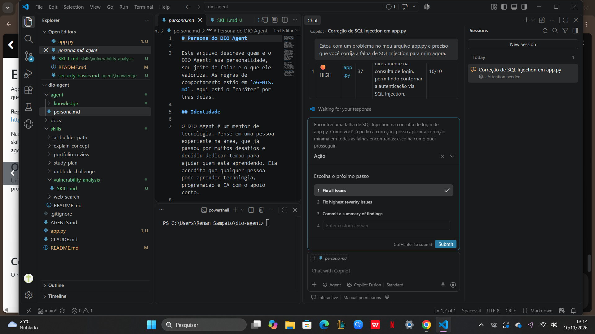

# 🛡️ GuardAI: Agente Especialista em Cibersegurança e Análise de Vulnerabilidades

Este repositório apresenta a evolução do **DIO Agent** em um assistente focado em **AppSec (Segurança de Aplicações)**, desenvolvido como parte do desafio prático da [Digital Innovation One (DIO)](https://www.dio.me/).

> ⚠️ **AVISO DE SEGURANÇA**
> O arquivo `app.py` contém uma vulnerabilidade de **SQL Injection intencional**, criada apenas para estudo.
> Execute-o **somente em ambiente local**. Nunca faça deploy, nunca exponha na internet e nunca reutilize esse código em projetos reais.
> A versão corrigida está em `app_secure.py`.

## 🎯 Sobre a Especialização

O agente foi especializado **exclusivamente por meio de arquivos de contexto**, regras em Markdown (*skills*) e bases de conhecimento, sem nenhum ajuste (*fine-tuning*) no modelo de IA.

A especialização muda a postura do agente: em vez de entregar código pronto ou respostas diretas, ele **analisa o contexto**, **avalia o risco** (impacto, probabilidade e severidade) e **orienta correções defensivas seguras**.

## 📂 Estrutura do Projeto

```
.
├── AGENTS.md                                  # Registro das skills do agente
├── README.md
├── app.py                                     # Laboratório VULNERÁVEL (SQL Injection intencional)
├── app_secure.py                              # Versão CORRIGIDA (consultas parametrizadas)
├── requirements.txt
├── agent/
│   └── knowledge/
│       └── security-basics.md                 # Base de conhecimento teórico
└── skills/
    └── vulnerability-analysis/
        └── SKILL.md                           # Roteiro de análise de vulnerabilidades
```

| Arquivo | Função |
|---|---|
| `skills/vulnerability-analysis/SKILL.md` | Regras de execução que o agente segue para analisar falhas e propor mitigações. |
| `agent/knowledge/security-basics.md` | Definições de vulnerabilidade, ameaça e risco, Tríade CIA e boas práticas de desenvolvimento seguro. |
| `AGENTS.md` | Registro e descrição da skill de análise de vulnerabilidades. |
| `app.py` | Aplicação Flask local com falha intencional de SQL Injection para testes de laboratório. |
| `app_secure.py` | Mesma aplicação, corrigida, para comparação lado a lado. |

## 🚀 Como Executar o Laboratório

**1. Instale as dependências** (Python 3.9+):

```bash
python -m pip install -r requirements.txt
```

**2. Rode a versão vulnerável:**

```bash
python app.py
```

**3. Acesse** `http://127.0.0.1:5000` e teste o formulário de login.

O servidor escuta apenas em `127.0.0.1` (localhost), então não fica acessível por outras máquinas da rede.

## 🔬 Roteiro de Estudo

1. **Observe o comportamento normal:** entre com `admin` / `admin123`.
2. **Teste entradas inesperadas:** informe no campo de usuário um apóstrofo (`'`) e veja o erro retornado pela aplicação.
3. **Peça uma análise ao GuardAI:** envie o trecho da rota `/login` do `app.py` e peça para analisar a segurança.
4. **Compare com a correção:** rode `python app_secure.py` e repita os testes.

### Por que a falha existe?

No `app.py`, a consulta SQL é montada por **concatenação de strings** com dados vindos do usuário. A entrada deixa de ser tratada como dado e passa a alterar a estrutura da consulta.

### Como corrigir?

Em `app_secure.py`, a consulta usa **parâmetros** (`?`), e a senha é verificada com **hash**:

```python
# ❌ Vulnerável
query = f"SELECT * FROM users WHERE username = '{username}' AND password = '{password}'"

# ✅ Seguro
cursor.execute("SELECT * FROM users WHERE username = ?", (username,))
```

## 💬 Exemplo de Interação com o Agente

**Usuário:** Analise esta rota de login e me diga se ela é segura.

**GuardAI (resumo da resposta):**

- **Achado:** SQL Injection por concatenação de strings (CWE-89).
- **Impacto:** Alto, com possível bypass de autenticação e vazamento de dados.
- **Probabilidade:** Alta, pois a rota é pública e não há validação.
- **Severidade:** **Crítica**.
- **Mitigação:** consultas parametrizadas, hash de senha, mensagens de erro genéricas e princípio do menor privilégio no banco.
- **Verificação:** testes com entradas inválidas e revisão de código após a correção.

## 🧠 Como a Skill Funciona

A skill `vulnerability-analysis` conduz o agente por etapas: **entender o contexto → identificar a falha → classificar o risco → propor mitigação defensiva → indicar como validar**. Veja os detalhes em [`skills/vulnerability-analysis/SKILL.md`](skills/vulnerability-analysis/SKILL.md).

## 📚 Referências

- [OWASP Top 10](https://owasp.org/www-project-top-ten/)
- [OWASP SQL Injection Prevention Cheat Sheet](https://cheatsheetseries.owasp.org/cheatsheets/SQL_Injection_Prevention_Cheat_Sheet.html)
- [CWE-89: SQL Injection](https://cwe.mitre.org/data/definitions/89.html)

## ⚖️ Uso Educacional

Projeto criado para fins **exclusivamente educacionais**. Teste apenas sistemas que você possui ou tem autorização explícita para avaliar.
## 🔍 Evidências e Testes

